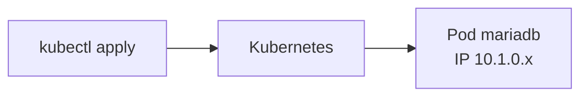

# 1단계: Pod

[← 전체 안내](../README.md) · **1. Pod** · [2. Deployment →](../02-deployment/README.md)

**Pod**는 Kubernetes에서 컨테이너를 실행하는 가장 작은 단위입니다. `docker run`으로 컨테이너 하나를 띄우는 것과 비슷합니다.
이 단계에서는 MariaDB Pod 하나를 직접 만들어 보고, **Pod만으로는 부족한 점**을 확인합니다.



## 파일

| 파일 | 내용 |
|---|---|
| `00-namespace.yaml` | 실습용 이름공간 `memo` |
| `10-mariadb-pod.yaml` | MariaDB 컨테이너 1개를 실행하는 Pod |

> VS Code에서 `One or more containers do not have resources - this can cause noisy neighbor issues` 경고가 보여도 실행에는 문제가 없습니다. CPU와 메모리 설정(`resources`)은 [7단계](../07-complete/README.md#resources)에서 배우므로 1~6단계 YAML에는 일부러 넣지 않았습니다.

YAML의 기본 모양은 모든 리소스가 같습니다.

```yaml
apiVersion: v1          # API 버전
kind: Pod               # 리소스 종류
metadata:               # 이름, Namespace, 이름표(labels)
  name: mariadb
  namespace: memo
spec:                   # 원하는 상태 (종류마다 내용이 다름)
  containers: [...]
```

## 실행

```bash
kubectl apply -f 01-pod/
#   namespace/memo created
#   pod/mariadb created

kubectl get pods -n memo -w            # STATUS 가 Running 이 될 때까지 (Ctrl+C 로 빠져나오기)
#   NAME      READY   STATUS              RESTARTS   AGE
#   mariadb   0/1     ContainerCreating   0          3s
#   mariadb   1/1     Running             0          15s
```

## 살펴보기

```bash
# Pod IP 와 실행 중인 노드
kubectl get pods -n memo -o wide

# 자세한 정보: 이미지, 환경 변수, 아래쪽 Events (이미지 받기 → 컨테이너 시작 기록)
kubectl describe pod mariadb -n memo

# 로그 (= docker logs)
kubectl logs mariadb -n memo

# 컨테이너 안에서 DB 접속 (= docker exec)
kubectl exec -it mariadb -n memo -- mariadb -uboot -pboot-pass-1234 boot_db
```

DB 안에서 테이블을 하나 만들어 둡니다.

```sql
CREATE TABLE test (id INT);
INSERT INTO test VALUES (1);
SELECT * FROM test;
exit
```

## Pod의 한계 확인

```bash
# Pod 삭제
kubectl delete pod mariadb -n memo

kubectl get pods -n memo
#   No resources found in memo namespace.
```

| 확인한 것 | 문제 | 해결하는 단계 |
|---|---|---|
| Pod를 지우면 **다시 생기지 않음** | 컨테이너가 죽어도 아무도 되살려 주지 않음 | [2. Deployment](../02-deployment/README.md) |
| 다시 `apply`하면 **IP가 바뀜** (`-o wide`로 확인) | 다른 Pod가 접속할 고정 주소가 없음 | [3. Service](../03-service/README.md) |
| 다시 만들면 `test` 테이블이 **없음** | DB 데이터가 컨테이너와 함께 사라짐 | [6. PVC](../06-pvc/README.md) |
| YAML에 비밀번호가 그대로 보임 | Git에 올리면 유출 | [5. Secret](../05-secret/README.md) |

실무에서는 Pod를 직접 만들지 않고, 다음 단계의 **Deployment**가 Pod를 만들게 합니다.

## 정리

```bash
kubectl delete namespace memo
```

---

[← 전체 안내](../README.md) · [2. Deployment →](../02-deployment/README.md)
