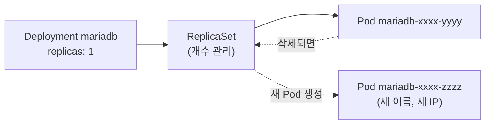

# 2단계: Deployment

[← 1. Pod](../01-pod/README.md) · **2. Deployment** · [3. Service →](../03-service/README.md)

**Deployment**는 "이런 Pod를 항상 N개 유지해 줘"라는 선언입니다. Pod가 죽거나 지워지면 Deployment가 **자동으로 새 Pod를 만듭니다.**
compose의 `restart: unless-stopped`보다 한 단계 더 나아가, 개수 유지와 버전 교체(롤링 업데이트)까지 맡습니다.



## 파일

| 파일 | 1단계와 달라진 점 |
|---|---|
| `10-mariadb-deployment.yaml` | Pod 내용을 `template:` 안으로 옮기고, `replicas`, `selector` 추가 |

Deployment YAML의 핵심 세 가지입니다.

```yaml
spec:
  replicas: 1                 # 몇 개 유지할지
  selector:
    matchLabels:
      app: mariadb            # "이 이름표가 붙은 Pod 가 내 Pod"
  template:                   # Pod 설계도 (1단계 Pod YAML 과 거의 같음)
    metadata:
      labels:
        app: mariadb          # ← selector 와 반드시 같아야 함
    spec:
      containers: [...]
```

## 실행

```bash
kubectl apply -f 02-deployment/

kubectl get deploy,rs,pods -n memo
#   NAME                      READY   UP-TO-DATE   AVAILABLE
#   deployment.apps/mariadb   1/1     1            1
#   NAME                                 DESIRED   CURRENT   READY
#   replicaset.apps/mariadb-7c9d8f6b4d   1         1         1
#   NAME                           READY   STATUS    RESTARTS
#   pod/mariadb-7c9d8f6b4d-k2x8p   1/1     Running   0
```

Pod 이름 뒤에 임의의 글자가 붙습니다. Deployment가 만든 Pod라는 표시입니다.

## 자동 복구 확인

터미널 두 개를 엽니다.

```bash
# 터미널 1: 변화 지켜보기
kubectl get pods -n memo -w

# 터미널 2: Pod 삭제 (이름은 get pods 로 확인한 실제 이름)
kubectl delete pod mariadb-7c9d8f6b4d-k2x8p -n memo
```

터미널 1에서 기존 Pod가 `Terminating`되는 동시에 **새 이름의 Pod**가 `ContainerCreating` → `Running`이 됩니다.

```bash
kubectl get pods -n memo -o wide      # 이름과 IP 가 바뀐 것 확인
```

## 실습

**1. 컨테이너 안에서 프로세스가 죽으면?**
```bash
kubectl exec -n memo deploy/mariadb -- sh -c 'kill 1'
kubectl get pods -n memo              # 같은 Pod 의 RESTARTS 가 1 로 증가
```
Pod는 그대로 두고 컨테이너만 재시작합니다. Pod 삭제와의 차이를 확인하세요.

**2. 데이터는?**
1단계처럼 `test` 테이블을 만든 뒤 Pod를 삭제해 보세요. 새 Pod에는 테이블이 **없습니다.** Pod는 되살아나지만 데이터는 되살아나지 않습니다.

```bash
kubectl exec -it -n memo deploy/mariadb -- mariadb -uboot -pboot-pass-1234 boot_db -e "CREATE TABLE test (id INT); SHOW TABLES;"
kubectl delete pod -n memo -l app=mariadb       # -l: 이름표로 지정 (이름을 몰라도 됨)
kubectl exec -it -n memo deploy/mariadb -- mariadb -uboot -pboot-pass-1234 boot_db -e "SHOW TABLES;"   # 비어 있음
```

> `deploy/mariadb`처럼 쓰면 Deployment의 Pod 하나를 자동으로 골라 줍니다. Pod 이름이 바뀌어도 같은 명령을 쓸 수 있습니다.

## 남은 문제

| 문제 | 해결하는 단계 |
|---|---|
| Pod 이름과 IP가 바뀌어서 백엔드가 접속할 주소를 정할 수 없음 | [3. Service](../03-service/README.md) |
| Pod가 다시 만들어지면 DB 데이터가 사라짐 | [6. PVC](../06-pvc/README.md) |

## 정리

```bash
kubectl delete namespace memo
```

> `kubectl delete pod`만 하면 Deployment가 계속 되살립니다. 완전히 지우려면 Deployment를 지우세요 (`kubectl delete deploy mariadb -n memo`).

---

[← 1. Pod](../01-pod/README.md) · [전체 안내](../README.md) · [3. Service →](../03-service/README.md)
