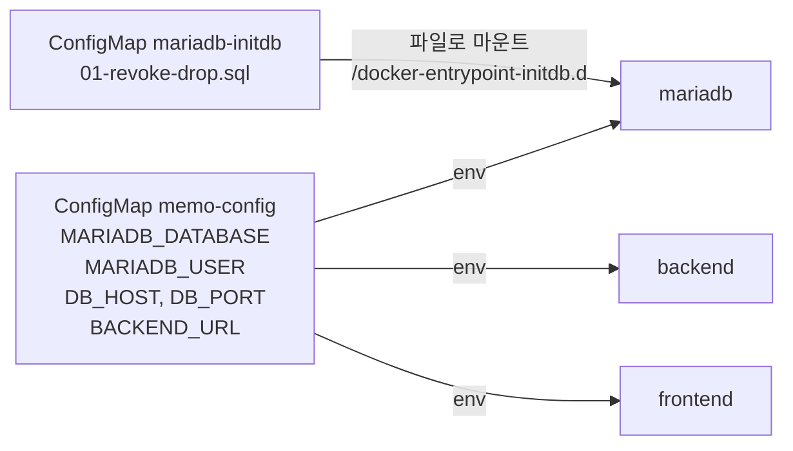

# 4단계: ConfigMap

[← 3. Service](../03-service/README.md) · **4. ConfigMap** · [5. Secret →](../05-secret/README.md)

**ConfigMap**은 비밀이 아닌 설정 값을 한곳에 모아 두는 리소스입니다. compose의 `.env`와 비슷한 역할입니다.
ConfigMap은 두 가지 방법으로 씁니다.

| 쓰는 방법 | 이 단계에서 |
|---|---|
| **환경 변수**로 넣기 | DB 이름, 계정, 주소, `BACKEND_URL` → `memo-config` |
| **파일**로 마운트하기 | MariaDB 초기화 SQL → `mariadb-initdb` (compose의 `./db/init` 마운트와 같음) |



## 파일

| 파일 | 3단계와 달라진 점 |
|---|---|
| `01-memo-config.yaml` | **추가**: 설정 값 ConfigMap |
| `02-mariadb-initdb.yaml` | **추가**: 초기화 SQL ConfigMap (08-3의 `db/init/01-revoke-drop.sql`과 같은 내용) |
| `10-mariadb-deployment.yaml` | DB 이름, 계정은 ConfigMap에서, 초기화 SQL을 볼륨으로 마운트 |
| `20-backend-deployment.yaml` | DB 주소, 이름, 계정은 ConfigMap에서 |
| `30-frontend-deployment.yaml` | `BACKEND_URL`은 ConfigMap에서 |
| Service 3개 | 변경 없음 |

**환경 변수로 쓰기**
```yaml
env:
  - name: MARIADB_USER            # 컨테이너 안의 환경 변수 이름
    valueFrom:
      configMapKeyRef:
        name: memo-config         # ConfigMap 이름
        key: MARIADB_USER         # ConfigMap 안의 키
```

**파일로 쓰기**
```yaml
containers:
  - volumeMounts:
      - name: initdb
        mountPath: /docker-entrypoint-initdb.d   # 이 폴더에 ConfigMap 의 키 이름으로 파일이 생김
volumes:
  - name: initdb
    configMap:
      name: mariadb-initdb
```

> 참고: 키를 하나씩 적지 않고 ConfigMap 전체를 한 번에 넣는 `envFrom: - configMapRef: { name: memo-config }`도 있습니다. 이 실습은 어떤 값이 어디로 가는지 보이도록 하나씩 적었습니다.

## 실행

```bash
kubectl apply -f 04-configmap/
kubectl get pods -n memo -w            # 모두 Running (backend 는 처음 1~2번 재시작할 수 있음)
```

http://localhost:30080 에서 3단계와 똑같이 동작하면 성공입니다.

## 살펴보기

```bash
# ConfigMap 내용
kubectl get configmap -n memo
kubectl describe configmap memo-config -n memo

# 환경 변수로 잘 들어갔는지
kubectl exec -n memo deploy/backend -- env | grep -E "DB_|MARIADB_"

# 파일로 잘 들어갔는지
kubectl exec -n memo deploy/mariadb -- ls /docker-entrypoint-initdb.d
kubectl exec -n memo deploy/mariadb -- cat /docker-entrypoint-initdb.d/01-revoke-drop.sql

# 초기화 SQL 이 실행됐는지: boot 계정에 DROP 권한이 없어야 함
kubectl exec -n memo deploy/mariadb -- mariadb -uboot -pboot-pass-1234 -e "SHOW GRANTS;"
```

## 실습: ConfigMap 값 바꾸기

`BACKEND_URL`을 잘못된 값으로 바꿔서, **바꾼 값이 언제 적용되는지** 확인합니다.

```bash
kubectl edit configmap memo-config -n memo      # BACKEND_URL 을 http://backend-x:8080 으로 바꾸고 저장
kubectl get pods -n memo -l app=frontend        # 아무 변화 없음, 화면도 정상
```

환경 변수는 **Pod가 시작할 때 한 번만** 읽습니다. Pod를 새로 만들어야 적용됩니다.

```bash
kubectl rollout restart deploy/frontend -n memo
kubectl get pods -n memo -l app=frontend -w     # 새 Pod 가 CrashLoopBackOff
kubectl logs -n memo deploy/frontend            # host not found in upstream "backend-x"
```

원래대로 되돌립니다.

```bash
kubectl apply -f 04-configmap/01-memo-config.yaml   # 파일 내용으로 되돌림
kubectl rollout restart deploy/frontend -n memo
```

> `kubectl edit`로 바꾼 값은 YAML 파일에 남지 않습니다. 실무에서는 **YAML을 고치고 `kubectl apply`**하는 방식으로 관리합니다. 파일이 곧 기록이 됩니다.

## 남은 문제

설정 값은 모였지만, 비밀번호 `boot-pass-1234`는 여전히 mariadb와 backend Deployment **두 곳에 그대로** 적혀 있습니다. → [5. Secret](../05-secret/README.md)

## 정리

```bash
kubectl delete namespace memo
```

---

[← 3. Service](../03-service/README.md) · [전체 안내](../README.md) · [5. Secret →](../05-secret/README.md)
