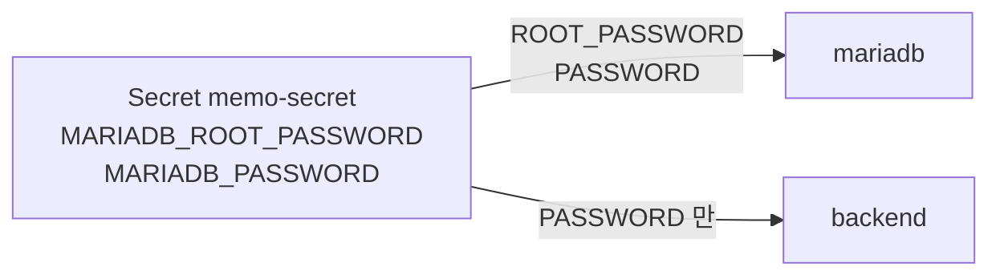

# 5단계: Secret

[← 4. ConfigMap](../04-configmap/README.md) · **5. Secret** · [6. PVC →](../06-pvc/README.md)

**Secret**은 비밀번호, API 키처럼 숨겨야 하는 값을 담는 리소스입니다. 쓰는 방법은 ConfigMap과 거의 같고, 이름만 `secretKeyRef`입니다.



- 비밀번호는 Secret **한 곳**에만 있고, mariadb와 backend는 같은 값을 참조합니다. 두 곳의 값이 어긋날 일이 없습니다.
- backend에는 **root 비밀번호를 전달하지 않습니다.** 앱에 필요 없는 권한은 주지 않는다는 원칙으로, compose에서 앱 컨테이너에 `env_file`을 쓰지 않았던 것과 같습니다.

## ConfigMap과 Secret 비교

| | ConfigMap | Secret |
|---|---|---|
| 넣는 값 | DB 이름, 주소, URL | 비밀번호, 토큰, 키 |
| `kubectl describe` | 값이 보임 | 크기만 보임 (`MARIADB_PASSWORD: 19 bytes`) |
| 저장 형식 | 평문 | **base64 인코딩** (암호화 아님) |
| 권한 | 보통 누구나 읽음 | RBAC으로 읽기 권한을 따로 제한할 수 있음 |
| Git | 올려도 됨 | **실제 값은 올리지 않음** |

> **Secret은 암호화가 아닙니다.** base64는 누구나 되돌릴 수 있는 인코딩입니다. Secret의 보호는 "기본 출력에 값을 숨김 + 권한 분리"이고, 진짜 암호화는 클러스터 설정(etcd 암호화)이나 외부 비밀 저장소(AWS Secrets Manager, Vault 등)로 합니다.

## 파일

| 파일 | 4단계와 달라진 점 |
|---|---|
| `03-memo-secret.yaml` | **추가**: 비밀번호 2개 (`stringData`에 평문으로 쓰면 저장할 때 base64로 바뀜) |
| `10-mariadb-deployment.yaml` | 비밀번호 2개를 Secret에서 |
| `20-backend-deployment.yaml` | `MARIADB_PASSWORD`를 Secret에서 |
| 나머지 | 변경 없음 |

```yaml
env:
  - name: MARIADB_PASSWORD
    valueFrom:
      secretKeyRef:               # configMapKeyRef 와 모양이 같음
        name: memo-secret
        key: MARIADB_PASSWORD
```

## 실행

**먼저 `03-memo-secret.yaml`의 비밀번호를 다른 값으로 바꾸세요.**

```bash
kubectl apply -f 05-secret/
kubectl get pods -n memo -w
```

http://localhost:30080 에서 정상 동작하면 성공입니다. 이제 Deployment YAML 어디에도 비밀번호가 없습니다.

```bash
grep -rn "pass" 05-secret/*deployment.yaml      # 키 이름(MARIADB_PASSWORD)만 나오고 값은 없음
```

## 살펴보기

```bash
kubectl get secret -n memo
kubectl describe secret memo-secret -n memo
#   Data
#   ====
#   MARIADB_PASSWORD:       19 bytes        ← 값은 표시하지 않음
#   MARIADB_ROOT_PASSWORD:  19 bytes

# base64 로 저장된 값 (암호화가 아니라는 것을 직접 확인)
kubectl get secret memo-secret -n memo -o jsonpath='{.data.MARIADB_PASSWORD}'
kubectl get secret memo-secret -n memo -o jsonpath='{.data.MARIADB_PASSWORD}' | base64 -d     # 원래 값이 보임

# backend 에 root 비밀번호가 없는지
kubectl exec -n memo deploy/backend -- env | grep PASSWORD     # MARIADB_PASSWORD 만 있어야 함
```

## 실습: 파일 없이 Secret 만들기

실제 비밀번호를 YAML 파일에 쓰지 않고 명령으로 만들 수 있습니다. 이렇게 하면 비밀번호가 Git에 들어갈 위험이 없습니다.

```bash
kubectl delete namespace memo
kubectl apply -f 05-secret/00-namespace.yaml

kubectl create secret generic memo-secret -n memo \
  --from-literal=MARIADB_ROOT_PASSWORD='내가_정한_root_비밀번호' \
  --from-literal=MARIADB_PASSWORD='내가_정한_앱_비밀번호'

# 03-memo-secret.yaml 을 빼고 나머지만 적용
kubectl apply -f 05-secret/01-memo-config.yaml -f 05-secret/02-mariadb-initdb.yaml
kubectl apply -f 05-secret/10-mariadb-deployment.yaml -f 05-secret/11-mariadb-service.yaml
kubectl apply -f 05-secret/20-backend-deployment.yaml -f 05-secret/21-backend-service.yaml
kubectl apply -f 05-secret/30-frontend-deployment.yaml -f 05-secret/31-frontend-service.yaml
```

> 08-4의 `.env` 파일을 그대로 쓰려면 `--from-env-file=.env`도 됩니다. 단, `.env`의 모든 값이 Secret에 들어가므로 비밀이 아닌 값은 ConfigMap으로 나누는 것이 좋습니다.

## 실습: 이름이 틀리면?

`20-backend-deployment.yaml`에서 `key: MARIADB_PASSWORD`를 `key: MARIADB_PASS`로 바꿔 적용해 보세요.

```bash
kubectl get pods -n memo -l app=backend
#   STATUS: CreateContainerConfigError
kubectl describe pod -n memo -l app=backend | grep -A2 Warning
#   couldn't find key MARIADB_PASS in Secret memo/memo-secret
```

참조하는 Secret이나 키가 없으면 컨테이너가 **시작조차 하지 않습니다.** 확인했으면 원래대로 되돌리세요.

## 남은 문제

설정과 비밀번호는 정리됐지만, mariadb Pod가 다시 만들어지면 **메모가 모두 사라집니다.** → [6. PVC](../06-pvc/README.md)

```bash
kubectl delete pod -n memo -l app=mariadb
```

새 MariaDB Pod는 **빈 DB**로 시작합니다. 화면을 새로고침하면 `memo` 테이블이 없어서 오류가 납니다. Flyway는 backend가 **시작할 때만** 테이블을 만들기 때문입니다.

```bash
kubectl rollout restart deploy/backend -n memo   # Flyway 가 V1~V3 를 다시 적용 → V2 의 첫 메모 1개만 남음
```

## 정리

```bash
kubectl delete namespace memo
```

---

[← 4. ConfigMap](../04-configmap/README.md) · [전체 안내](../README.md) · [6. PVC →](../06-pvc/README.md)
