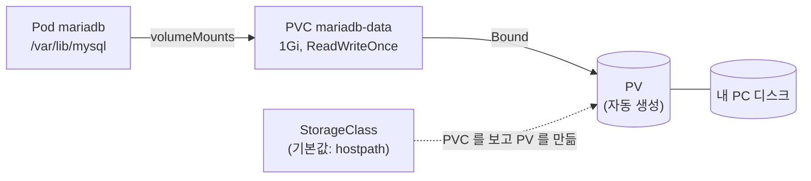

# 6단계: PVC (PersistentVolumeClaim)

[← 5. Secret](../05-secret/README.md) · **6. PVC** · [7. 완성 →](../07-complete/README.md)

컨테이너 안의 파일은 컨테이너와 함께 사라집니다. **PVC**는 "디스크 1GB를 빌려 주세요"라는 **요청서**이고, Kubernetes는 이 요청에 맞는 **PV(실제 저장 공간)**를 연결해 줍니다. PV는 Pod와 따로 존재하므로 Pod를 다시 만들어도 데이터가 남습니다. compose의 이름 있는 볼륨(`mariadb-data`)과 같은 역할입니다.



| 용어 | 역할 | 비유 |
|---|---|---|
| **PVC** | 필요한 크기와 사용 방식을 적은 요청서 (개발자가 작성) | 주차권 신청서 |
| **PV** | 실제 저장 공간 | 주차 자리 |
| **StorageClass** | PVC를 보고 PV를 자동으로 만들어 주는 방식 (클러스터마다 다름) | 주차장 관리인 |

Docker Desktop에는 기본 StorageClass(`hostpath`)가 있어서 PVC만 만들면 PV가 자동으로 생깁니다(동적 프로비저닝). 클라우드에서는 같은 PVC로 EBS 같은 클라우드 디스크가 만들어집니다.

## 파일

| 파일 | 5단계와 달라진 점 |
|---|---|
| `04-mariadb-pvc.yaml` | **추가**: 1Gi, `ReadWriteOnce` |
| `10-mariadb-deployment.yaml` | `/var/lib/mysql`을 PVC에 마운트, `strategy: Recreate` |
| 나머지 | 변경 없음 |

```yaml
spec:
  strategy:
    type: Recreate                  # 옛 Pod 를 먼저 지우고 새 Pod 시작
  template:
    spec:
      containers:
        - volumeMounts:
            - name: data
              mountPath: /var/lib/mysql      # MariaDB 데이터 폴더
      volumes:
        - name: data
          persistentVolumeClaim:
            claimName: mariadb-data          # 04-mariadb-pvc.yaml
```

**왜 `Recreate`인가요?** Deployment의 기본 교체 방식(`RollingUpdate`)은 새 Pod를 먼저 띄우고 옛 Pod를 지웁니다. 그러면 잠깐 동안 MariaDB 두 개가 같은 데이터 폴더를 쓰려고 해서 충돌합니다. `Recreate`는 잠깐 끊기는 대신 안전합니다.

## 실행

```bash
kubectl apply -f 06-pvc/

kubectl get pvc,pv -n memo
#   NAME                                 STATUS   VOLUME          CAPACITY   ACCESS MODES   STORAGECLASS
#   persistentvolumeclaim/mariadb-data   Bound    pvc-3f2a...     1Gi        RWO            hostpath
#   NAME                           CAPACITY   RECLAIM POLICY   STATUS   CLAIM
#   persistentvolume/pvc-3f2a...   1Gi        Delete           Bound    memo/mariadb-data
```

`STATUS`가 **Bound**면 PVC에 PV가 연결된 것입니다. `Pending`에서 멈춰 있으면 기본 StorageClass가 있는지 확인하세요 (`kubectl get storageclass`).

## 데이터가 남는지 확인

1. http://localhost:30080 에서 메모를 2~3개 저장합니다.
2. MariaDB Pod를 지웁니다.
   ```bash
   kubectl delete pod -n memo -l app=mariadb
   kubectl get pods -n memo -l app=mariadb -w     # 새 Pod 가 Running
   ```
3. 화면을 새로고침합니다. **메모가 그대로 남아 있으면 성공**입니다.

5단계와 달리 backend를 재시작할 필요도 없습니다. 테이블과 데이터가 그대로이고, backend의 DB 연결 풀이 새 Pod에 다시 연결합니다. 잠깐 동안은 배지가 `DB DOWN`으로 보일 수 있습니다.

```bash
# Deployment 를 지웠다가 다시 만들어도 PVC 가 남아 있으면 데이터 유지
kubectl delete deploy mariadb -n memo
kubectl apply -f 06-pvc/10-mariadb-deployment.yaml
```

## 알아 둘 점

- **초기화는 한 번만:** MariaDB는 데이터 폴더가 비어 있을 때만 계정을 만들고 초기화 SQL을 실행합니다. 6단계부터는 Secret의 비밀번호를 바꿔도 기존 DB 계정의 비밀번호는 바뀌지 않습니다. compose에서 `.env`를 바꿔도 볼륨이 있으면 그대로였던 것과 같습니다.
- **Namespace를 지우면 데이터도 삭제:** `kubectl delete namespace memo`는 PVC를 지우고, `RECLAIM POLICY: Delete`라서 PV와 데이터도 함께 삭제됩니다. compose의 `docker compose down -v`와 같습니다.
- **앱만 다시 띄우고 싶을 때:** Namespace 대신 Deployment만 지우세요.
  ```bash
  kubectl delete deploy --all -n memo     # PVC, ConfigMap, Secret, Service 는 남음
  kubectl apply -f 06-pvc/                # 다시 적용하면 기존 데이터로 시작
  ```
- **실무에서는 StatefulSet:** DB처럼 상태가 있는 앱은 보통 StatefulSet으로 실행합니다. Pod마다 고정 이름(`mariadb-0`)과 고정 PVC가 붙습니다. 이 실습은 개념을 단순하게 하려고 Deployment + PVC로 구성했습니다.

## 남은 문제

이제 3티어 앱이 모두 동작하지만, 아직 개선할 점이 있습니다. → [7. 완성](../07-complete/README.md)

| 문제 | 증상 |
|---|---|
| 시작 순서 | backend가 DB보다 먼저 떠서 1~2번 재시작함 |
| 준비 상태 | Spring Boot가 아직 시작 중인데 Service가 요청을 보내 화면에 오류가 잠깐 보임 |
| 자원 | 메모리 한도가 없어서 한 Pod가 노드 메모리를 다 쓸 수 있음 |
| 개수 | backend, frontend가 1개라 재시작하는 동안 서비스가 끊김 |

## 정리

```bash
kubectl delete namespace memo      # DB 데이터까지 삭제됨
```

---

[← 5. Secret](../05-secret/README.md) · [전체 안내](../README.md) · [7. 완성 →](../07-complete/README.md)
