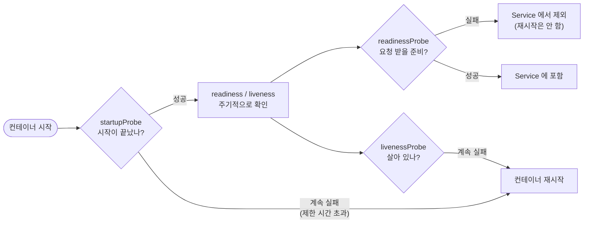
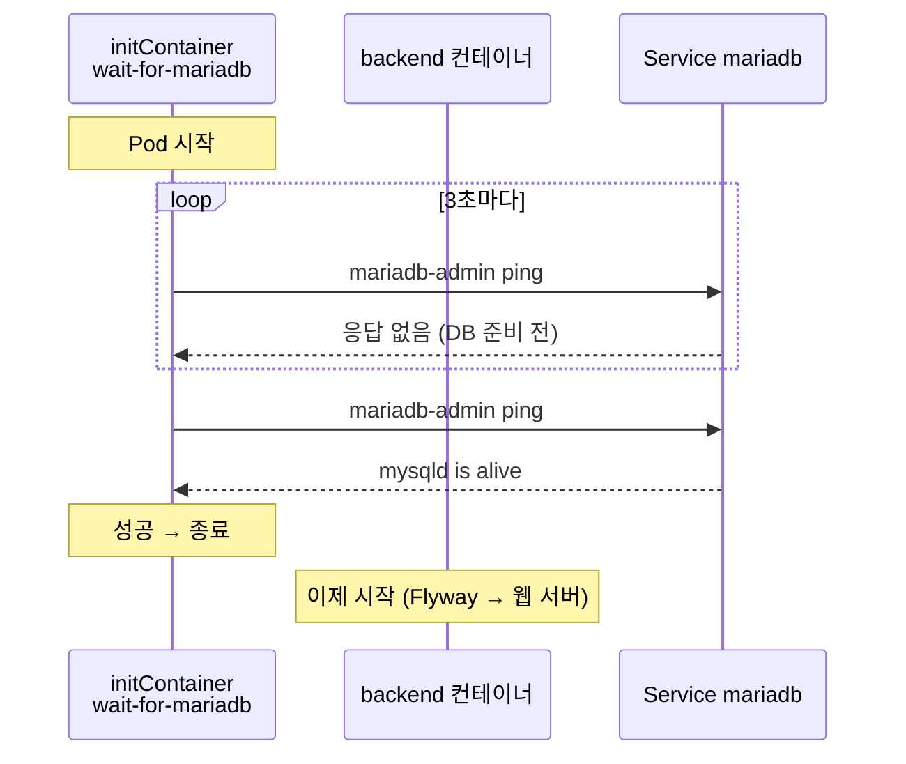

# 7단계: 완성 (probe, resources, initContainer)

[← 6. PVC](../06-pvc/README.md) · **7. 완성** · [전체 안내](../README.md)

1~6단계의 리소스(Pod, Deployment, Service, ConfigMap, Secret, PVC)는 그대로 두고, **운영에 필요한 설정**을 더한 완성본입니다.
compose의 `healthcheck`, `depends_on`, `mem_limit`이 Kubernetes에서 어떻게 바뀌는지 확인합니다.

| 추가한 것 | compose 에서는 | 해결하는 문제 |
|---|---|---|
| **probe** (startup / readiness / liveness) | `healthcheck:` | 준비 안 된 Pod로 요청이 감, 멈춘 컨테이너를 모름 |
| **initContainer** | `depends_on: condition: service_healthy` | backend가 DB보다 먼저 시작해서 재시작 |
| **resources** (requests / limits) | `mem_limit:` | 한 Pod가 노드 자원을 다 씀 |
| **replicas: 2** (backend, frontend) | - | 재시작이나 업데이트 중에도 서비스 유지 |

## probe 3종류



| probe | 질문 | 실패하면 | 이 실습에서 확인하는 곳 |
|---|---|---|---|
| `startupProbe` | 시작이 끝났나? | 기다림 (제한 시간을 넘으면 재시작) | Spring Boot 시작, MariaDB 첫 초기화 |
| `readinessProbe` | 요청을 받을 준비가 됐나? | **Service에서 빠짐** (재시작 없음) | backend: DB 연결 포함 |
| `livenessProbe` | 살아 있나? | **컨테이너 재시작** | backend: 앱 자체만 (DB 제외) |

| 컨테이너 | probe 방법 |
|---|---|
| mariadb | `healthcheck.sh --connect --innodb_initialized` (compose 의 `healthcheck`와 같은 명령) |
| backend | Actuator `/actuator/health/liveness`, `/actuator/health/readiness` |
| frontend | nginx `GET /` |

**backend의 liveness에 DB 상태를 넣지 않는 이유:** DB가 잠깐 끊겼을 때 backend까지 재시작되면 복구가 더 늦어집니다. DB 문제는 readiness로 "요청만 막고", liveness는 "앱 자체가 멈췄을 때"만 재시작합니다.

Spring Boot의 probe 전용 주소는 `application.properties`를 고치지 않고 **환경 변수**로 켰습니다.

```yaml
- name: MANAGEMENT_ENDPOINT_HEALTH_PROBES_ENABLED          # /actuator/health/liveness, /readiness 켜기
  value: "true"
- name: MANAGEMENT_ENDPOINT_HEALTH_GROUP_READINESS_INCLUDE # readiness 에 DB 상태 포함
  value: "readinessState,db"
```

## initContainer: DB를 기다린 뒤 시작



- initContainer는 본 컨테이너보다 **먼저** 실행되고, **성공해야** 본 컨테이너가 시작됩니다.
- mariadb Service는 mariadb의 readinessProbe가 통과해야 연결되므로, 결과적으로 "준비된 DB"를 기다립니다.
- `mariadb-admin ping`은 로그인 없이도 서버가 살아 있으면 성공을 돌려줍니다. 그래서 비밀번호가 필요 없습니다.

## resources

| 컨테이너 | requests (보장) | limits (한도) |
|---|---|---|
| mariadb | cpu 100m, memory 256Mi | memory 512Mi |
| backend (×2) | cpu 200m, memory 384Mi | memory 768Mi |
| frontend (×2) | cpu 50m, memory 32Mi | memory 128Mi |

- `requests`: 스케줄러가 Pod를 둘 노드를 고를 때 쓰는 기준입니다. 노드에 이만큼 여유가 없으면 `Pending`이 됩니다.
- `limits.memory`를 넘으면 컨테이너가 `OOMKilled`로 재시작됩니다. backend의 `-XX:MaxRAMPercentage=60`은 이 한도(768Mi)의 60%를 Java 힙으로 씁니다.
- CPU는 `limits`를 두지 않았습니다. CPU 한도를 넘으면 느려지기만(throttling) 하고, Spring Boot는 시작할 때 CPU를 많이 써서 한도가 낮으면 시작이 아주 느려집니다.
- 합계 requests는 약 메모리 1.1Gi입니다. Docker Desktop의 메모리 설정(Settings > Resources)이 부족하면 늘려 주세요.

## 실행

```bash
kubectl apply -f 07-complete/

kubectl get pods -n memo -w
#   mariadb-...    0/1   Running     0     ← startupProbe 통과 전 (READY 0/1)
#   backend-...    0/1   Init:0/1    0     ← initContainer 가 DB 를 기다리는 중
#   mariadb-...    1/1   Running     0
#   backend-...    0/1   PodInitializing
#   backend-...    0/1   Running     0     ← Spring Boot 시작 중 (startupProbe)
#   backend-...    1/1   Running     0     ← readiness 통과, Service 에 포함
```

6단계와 비교해 **backend의 RESTARTS가 0**인 것을 확인하세요.

```bash
kubectl logs -n memo deploy/backend -c wait-for-mariadb     # initContainer 로그 (-c 로 컨테이너 지정)
#   waiting for mariadb:3306 ...
#   mariadb is ready
```

## 실습

**1. readiness 동작 보기: DB를 멈추면?**
```bash
kubectl scale deploy/mariadb --replicas=0 -n memo
kubectl get pods -n memo -l app=backend -w      # 잠시 후 READY 1/1 → 0/1 (재시작은 하지 않음)
kubectl get endpoints backend -n memo           # 백엔드 Pod 가 Service 에서 빠짐
kubectl scale deploy/mariadb --replicas=1 -n memo   # DB 가 돌아오면 다시 1/1
```

**2. 무중단 업데이트 (롤링 업데이트)**
```bash
kubectl rollout restart deploy/backend -n memo
kubectl rollout status deploy/backend -n memo
```
새 Pod가 readiness를 통과한 뒤에 옛 Pod를 하나씩 지웁니다. 그동안 화면을 계속 새로고침해도 끊기지 않습니다. 6단계(replicas 1, probe 없음)에서 같은 명령을 실행했을 때와 비교해 보세요.

**3. 새 이미지 배포**
GitHub Actions가 `:latest`를 새로 올렸다면 다음과 같이 반영합니다. `imagePullPolicy: Always`라서 새 Pod가 최신 이미지를 받습니다.
```bash
kubectl rollout restart deploy/backend deploy/frontend -n memo
```

**4. 되돌리기**
```bash
kubectl rollout history deploy/backend -n memo
kubectl rollout undo deploy/backend -n memo
```

## 전체 리소스 확인

```bash
kubectl get all,cm,secret,pvc -n memo
```

| 종류 | 이름 | 단계 |
|---|---|---|
| Namespace | `memo` | 1 |
| Deployment | `mariadb`(1), `backend`(2), `frontend`(2) | 2 |
| Service | `mariadb`, `backend` (ClusterIP), `frontend` (NodePort 30080) | 3 |
| ConfigMap | `memo-config`, `mariadb-initdb` | 4 |
| Secret | `memo-secret` | 5 |
| PVC | `mariadb-data` | 6 |
| probe, resources, initContainer | 각 Deployment 안 | 7 |

## 정리

```bash
kubectl delete namespace memo
```

---

[← 6. PVC](../06-pvc/README.md) · [전체 안내](../README.md)
