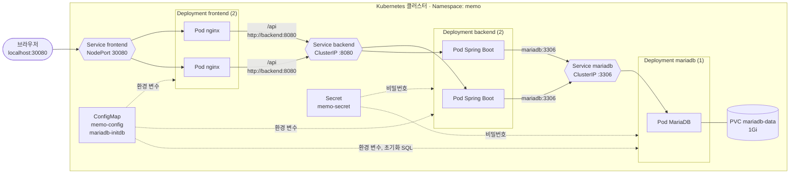
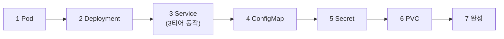

# 11-k8s-memo-3tier

07-2 React 클라이언트, 08-3 Spring Boot 메모 API, MariaDB로 이루어진 **3티어 메모 앱을 Kubernetes에 배포**하는 실습입니다.
Kubernetes를 처음 쓰는 개발자를 위해 **Pod → Deployment → Service → ConfigMap → Secret → PVC** 순서로 개념을 하나씩 더합니다.

이미지는 새로 만들지 않습니다. 08-4 EC2 배포에서 쓴 **Docker Hub 이미지를 그대로** 사용합니다.

| 계층 | 이미지 | Kubernetes 이름 |
|---|---|---|
| Frontend (React + nginx) | `hubusername/boot-flyway-web:latest` | `frontend` |
| Backend (Spring Boot + Flyway) | `hubusername/boot-flyway-app:latest` | `backend` |
| Database | `mariadb:10.11.18` (공식) | `mariadb` |

## 완성된 모습 (7단계)



- 외부에서 들어오는 곳은 **frontend Service(NodePort 30080)** 하나입니다. backend와 mariadb는 클러스터 안에서만 접속할 수 있습니다(ClusterIP).
- Pod끼리는 **Service 이름**(`backend`, `mariadb`)으로 접속합니다. compose에서 서비스 이름으로 접속하던 것과 같습니다.

## 단계

각 단계 폴더는 **그 단계까지의 내용을 모두 포함**합니다. 어느 폴더든 `kubectl apply -f <폴더>`로 바로 실행할 수 있습니다.

| 단계 | 폴더 | 새로 배우는 것 | 해결하는 문제 |
|---|---|---|---|
| 0 | [준비](#준비) | 클러스터, `kubectl`, Namespace | - |
| 1 | [01-pod](./01-pod/README.md) | **Pod**: 컨테이너를 실행하는 가장 작은 단위 | - |
| 2 | [02-deployment](./02-deployment/README.md) | **Deployment**: Pod 개수 유지, 자동 복구 | Pod를 지우면 다시 생기지 않음 |
| 3 | [03-service](./03-service/README.md) | **Service**: 고정 주소, 로드 밸런싱, 외부 공개 | Pod IP가 계속 바뀜 → **3티어 완성** |
| 4 | [04-configmap](./04-configmap/README.md) | **ConfigMap**: 설정 값, 설정 파일 | 같은 값이 여러 YAML에 흩어져 있음 |
| 5 | [05-secret](./05-secret/README.md) | **Secret**: 비밀번호 | 비밀번호가 YAML에 그대로 보임 |
| 6 | [06-pvc](./06-pvc/README.md) | **PVC**: 오래 남는 저장 공간 | Pod가 다시 만들어지면 DB 데이터가 사라짐 |
| 7 | [07-complete](./07-complete/README.md) | probe, resources, initContainer | 준비 안 된 Pod로 요청이 감, 시작 순서 |



## Docker Compose와 비교

08-3, 08-4에서 쓴 `compose.yaml`의 각 항목이 Kubernetes에서는 다음 리소스가 됩니다.

| compose.yaml | Kubernetes | 단계 |
|---|---|---|
| `services:` 아래 서비스 하나 | **Deployment** (+ 그 안의 Pod) | 1, 2 |
| `image:`, `command:`, `environment:` | Pod의 `image`, `args`, `env` | 1 |
| `restart: unless-stopped` | Deployment가 Pod 개수를 유지 (자동 복구) | 2 |
| 서비스 이름으로 접속 (`mariadb:3306`) | **Service** (ClusterIP) | 3 |
| `ports: "80:80"` | **Service** (NodePort / LoadBalancer) | 3 |
| `.env` + `${변수}` | **ConfigMap** | 4 |
| `./db/init:/docker-entrypoint-initdb.d` | ConfigMap을 볼륨으로 마운트 | 4 |
| `.env`의 비밀번호 | **Secret** | 5 |
| `volumes: mariadb-data:` | **PersistentVolumeClaim** | 6 |
| `healthcheck:` | readinessProbe, livenessProbe | 7 |
| `depends_on: condition: service_healthy` | initContainer + readinessProbe | 7 |
| `mem_limit:` | `resources.limits.memory` | 7 |
| `docker compose up -d` | `kubectl apply -f <폴더>` | - |
| `docker compose down -v` | `kubectl delete namespace memo` | - |

## 용어 정리

| 용어 | 한 줄 설명 |
|---|---|
| 클러스터 (Cluster) | Kubernetes가 관리하는 서버 묶음. 이 실습에서는 내 PC 한 대 |
| 노드 (Node) | 클러스터 안의 서버 한 대. Pod가 실제로 실행되는 곳 |
| `kubectl` | 클러스터에 명령을 보내는 CLI (`docker` 명령과 비슷한 역할) |
| 매니페스트 (Manifest) | "이런 상태를 원한다"를 적은 YAML 파일 |
| Namespace | 리소스를 묶는 이름공간. 이 실습은 모두 `memo` 안에 만듦 |
| Pod | 컨테이너 1개(또는 여러 개)를 감싼 실행 단위 |
| Deployment | "이런 Pod를 N개 유지해 줘". Pod가 죽으면 다시 만듦 |
| ReplicaSet | Deployment가 내부에서 쓰는 Pod 개수 관리자 (직접 만들 일은 거의 없음) |
| Service | Pod 묶음 앞의 고정 주소. 이름표(label)로 Pod를 찾음 |
| Label / Selector | Pod에 붙이는 이름표(`app: backend`)와 그 이름표로 찾는 조건 |
| ConfigMap | 비밀이 아닌 설정 값, 설정 파일 |
| Secret | 비밀번호 같은 민감한 값 (base64 인코딩일 뿐 암호화는 아님) |
| PVC / PV | 저장 공간 요청서(PVC)와 실제 저장 공간(PV) |
| Probe | Kubernetes가 컨테이너 상태를 주기적으로 확인하는 방법 |

Kubernetes는 **선언형**입니다. "컨테이너를 실행해"가 아니라 "이런 상태가 되어야 해"를 YAML로 적어 `kubectl apply`하면, Kubernetes가 실제 상태를 그 모습에 계속 맞춥니다.

* * *

## 준비

### 1. 로컬 Kubernetes 클러스터

이 실습은 **Docker Desktop의 Kubernetes**를 기준으로 합니다 (Windows, Mac).

1. Docker Desktop > **Settings > Kubernetes** > **Enable Kubernetes** 체크 > **Apply & restart**
2. 왼쪽 아래 Kubernetes 표시가 초록색(running)이 될 때까지 기다림 (처음에는 몇 분)
3. 확인
   ```bash
   kubectl version                   # Client, Server 버전이 모두 나오면 정상
   kubectl config current-context    # docker-desktop
   kubectl get nodes                 # docker-desktop   Ready
   ```

> `kubectl`은 Docker Desktop에 함께 들어 있습니다. 다른 클러스터(minikube, kind, 회사 클러스터)를 쓴다면 [접속 방법](#앱-접속-방법)만 다르고 나머지는 같습니다.

> **CPU 종류:** Docker Hub 이미지는 GitHub Actions가 만든 **x86(amd64)** 이미지입니다. Windows, Intel Mac은 그대로 동작하고, **Apple Silicon Mac**에서는 `exec format error`가 날 수 있습니다. 이때는 GitHub Actions에서 `platforms: linux/amd64,linux/arm64`로 이미지를 함께 만드세요 (08-4 README 참고).

### 2. 이미지 이름 바꾸기 (한 번만)

YAML의 `hubusername`을 **내 Docker Hub 아이디**로 바꿉니다. 이 폴더(`11-k8s-memo-3tier`) 안에서 실행하세요.

```bash
# Git Bash, Mac, Linux
grep -rl hubusername --include=*.yaml . | xargs sed -i 's/hubusername/내아이디/g'
```
```powershell
# PowerShell
Get-ChildItem -Recurse -Filter *.yaml | ForEach-Object { (Get-Content $_ -Raw) -replace 'hubusername','내아이디' | Set-Content $_ -NoNewline }
```

Docker Hub 저장소가 **Public**이어야 별도 설정 없이 받을 수 있습니다.

### 3. 폴더 구성

```
11-k8s-memo-3tier/
├── README.md                     ← 지금 보는 문서
├── 01-pod/                       mariadb Pod 1개
├── 02-deployment/                mariadb Deployment
├── 03-service/                   + mariadb, backend, frontend 의 Deployment / Service (3티어 동작)
├── 04-configmap/                 + memo-config, mariadb-initdb
├── 05-secret/                    + memo-secret
├── 06-pvc/                       + mariadb-data
└── 07-complete/                  + probe, resources, initContainer (완성본)
```

각 폴더의 파일 이름 앞 번호는 **적용 순서**입니다. `kubectl apply -f <폴더>`는 파일 이름 순서대로 적용합니다.

| 번호 | 내용 |
|---|---|
| `00` | Namespace |
| `01`~`04` | ConfigMap, Secret, PVC (Pod보다 먼저 있어야 함) |
| `10`~`11` | mariadb Deployment, Service |
| `20`~`21` | backend Deployment, Service |
| `30`~`31` | frontend Deployment, Service |

* * *

## 기본 사용법

```bash
# 적용 (만들기 / 바꾸기 모두 같은 명령)
kubectl apply -f 03-service/

# 상태 보기 (-n memo: memo Namespace 에서)
kubectl get all -n memo
kubectl get pods -n memo -w          # -w: 바뀔 때마다 계속 출력 (Ctrl+C 로 종료)

# 전부 삭제 (다음 단계로 넘어갈 때)
kubectl delete namespace memo
```

다음 단계로 넘어갈 때는 **Namespace를 지우고 새 폴더를 적용**하는 것이 가장 깔끔합니다. 각 폴더는 이전 단계 내용을 모두 포함하고 있습니다.

> 매번 `-n memo`를 붙이기 귀찮으면 기본 Namespace를 바꿔 둘 수 있습니다.
> `kubectl config set-context --current --namespace=memo` (되돌리기: `--namespace=default`)

## 앱 접속 방법

3단계부터 브라우저로 메모 앱에 접속할 수 있습니다.

| 클러스터 | 접속 주소 |
|---|---|
| Docker Desktop | http://localhost:30080 (NodePort) |
| minikube | `minikube service frontend -n memo --url`이 알려 주는 주소 |
| 어느 클러스터든 | `kubectl port-forward -n memo svc/frontend 8080:80` 실행 후 http://localhost:8080 |

`port-forward`는 터미널을 열어 두는 동안만 동작합니다. 같은 방법으로 백엔드나 DB에도 직접 접속해 볼 수 있습니다.

```bash
kubectl port-forward -n memo svc/backend 8081:8080    # http://localhost:8081/api/memos
kubectl port-forward -n memo svc/mariadb 3307:3306    # DBeaver: localhost:3307
```

## kubectl 자주 쓰는 명령

| 명령 | 하는 일 | docker 에서는 |
|---|---|---|
| `kubectl get pods -n memo` | Pod 목록 | `docker ps` |
| `kubectl get pods -n memo -o wide` | Pod IP, 노드까지 표시 | - |
| `kubectl describe pod <이름> -n memo` | 자세한 상태, **Events**(문제 원인) | `docker inspect` |
| `kubectl logs <Pod 이름> -n memo` | 로그 (`-f` 실시간, `--previous` 재시작 전 로그) | `docker logs` |
| `kubectl logs deploy/backend -n memo` | Deployment 의 Pod 하나의 로그 | - |
| `kubectl exec -it <Pod 이름> -n memo -- sh` | 컨테이너 안에서 셸 실행 | `docker exec -it` |
| `kubectl delete pod <이름> -n memo` | Pod 삭제 (Deployment 가 있으면 다시 생김) | `docker rm -f` |
| `kubectl scale deploy/backend --replicas=3 -n memo` | 개수 변경 | - |
| `kubectl rollout restart deploy/backend -n memo` | Pod 를 새로 만들기 (새 이미지, ConfigMap 반영) | - |
| `kubectl get events -n memo --sort-by=.lastTimestamp` | 최근 이벤트 (문제 찾을 때) | `docker events` |

## 자주 보는 상태와 해결

| `STATUS` | 의미 | 먼저 볼 것 |
|---|---|---|
| `Pending` | 아직 노드에 배치되지 않음 | `describe pod`의 Events (자원 부족, PVC 대기) |
| `ContainerCreating` | 이미지 받는 중, 볼륨 연결 중 | 잠시 기다리기, 오래 걸리면 Events |
| `ImagePullBackOff`, `ErrImagePull` | 이미지를 받지 못함 | `hubusername`을 바꿨는지, 이미지 이름 오타, Docker Hub Public 여부 |
| `CreateContainerConfigError` | 참조하는 ConfigMap / Secret 이나 키가 없음 | `describe pod`의 메시지, `kubectl get cm,secret -n memo` |
| `CrashLoopBackOff` | 컨테이너가 시작했다가 계속 종료됨 | `kubectl logs <Pod> --previous` |
| `Running` 인데 `READY 0/1` | readinessProbe 실패 (아직 준비 중이거나 문제) | `describe pod`의 Readiness probe failed 메시지 |
| `OOMKilled` (describe 의 Last State) | 메모리 한도 초과 | `resources.limits.memory` 늘리기 |
| `exec format error` (로그) | CPU 종류가 다른 이미지 | 위 "CPU 종류" 참고 |

| 증상 | 원인 | 해결 |
|---|---|---|
| backend 가 처음 1~2번 재시작 (3~6단계) | MariaDB 가 준비되기 전에 시작 | 정상. 7단계 initContainer 로 해결 |
| frontend 가 `CrashLoopBackOff`, 로그에 `host not found in upstream "backend"` | backend Service 가 없음 | `kubectl get svc -n memo`, 폴더 전체를 적용했는지 |
| 화면에 "백엔드에 연결할 수 없습니다" | backend Pod 가 준비되지 않음 | `kubectl get pods -n memo`, `kubectl logs deploy/backend -n memo` |
| ConfigMap 을 바꿨는데 반영이 안 됨 | 환경 변수는 Pod 가 시작할 때만 읽음 | `kubectl rollout restart deploy/<이름> -n memo` |
| Secret 비밀번호를 바꿨는데 DB 접속 실패 (6단계 이후) | MariaDB 는 데이터 폴더가 비어 있을 때만 계정을 만듦 | 실습이면 `kubectl delete namespace memo` 후 다시 적용 (데이터 삭제) |
| `localhost:30080` 접속 안 됨 | Docker Desktop 이 아닌 클러스터 | [접속 방법](#앱-접속-방법)의 `port-forward` 사용 |
| `provided port is already allocated` | 30080 을 다른 Service 가 사용 중 | `kubectl get svc -A`로 확인, `nodePort` 값 변경 |

## 정리

```bash
kubectl delete namespace memo      # 이 실습의 모든 리소스 삭제 (PVC, DB 데이터 포함)
```

Docker Desktop의 Kubernetes 자체를 끄려면 Settings > Kubernetes에서 **Enable Kubernetes**를 해제합니다. 켜 두면 메모리를 계속 사용합니다.

## 다음 단계

| 주제 | 내용 |
|---|---|
| StatefulSet | DB 같은 상태 있는 앱 전용 (Pod 마다 고정 이름 + 고정 디스크) |
| Ingress | 도메인, 경로별로 여러 Service 를 하나의 입구로 연결 (NodePort 대신) |
| Kustomize / Helm | 개발, 운영 환경별로 값만 바꿔 같은 YAML 재사용 |
| 클라우드 클러스터 | AWS EKS, GKE 등에 같은 YAML 배포 (Service 는 LoadBalancer, PVC 는 클라우드 디스크) |
