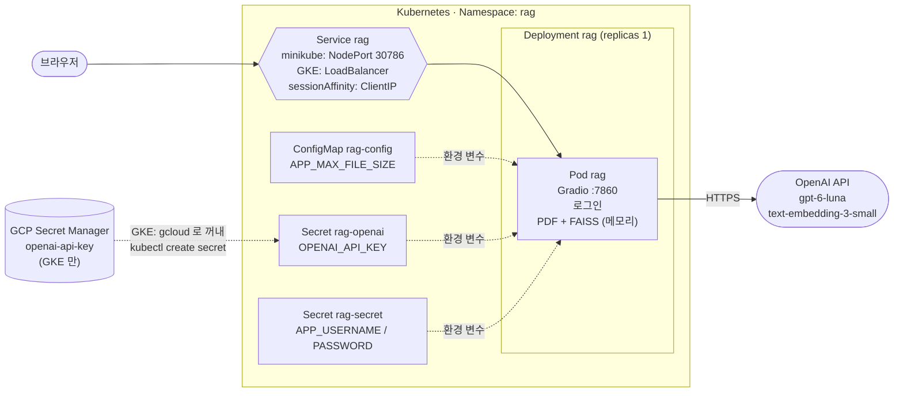
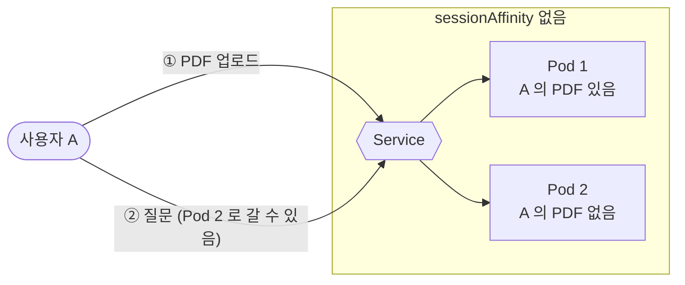
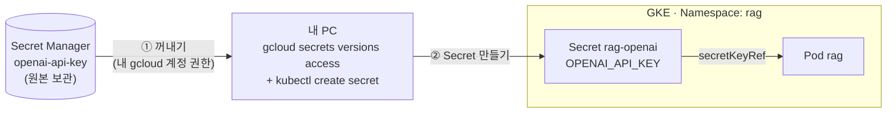
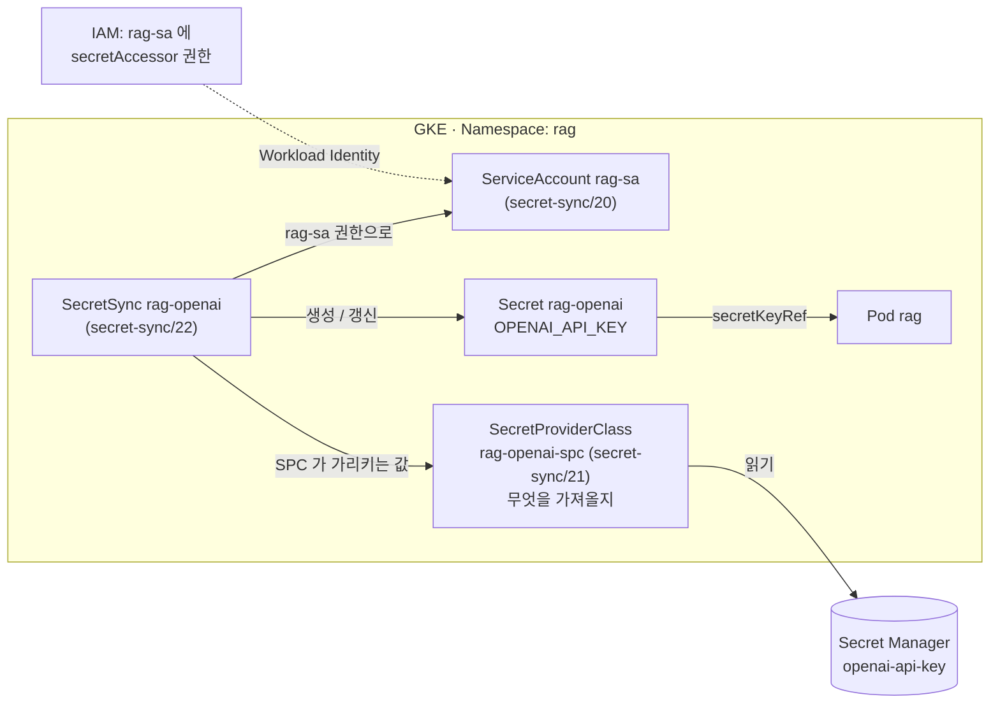

# 12-k8s-rag

10단계 **PDF 질의응답(RAG) Gradio 앱**을 Kubernetes에 배포합니다.
EC2 배포(`10-ec2-deploy`)에서 쓴 Docker Hub 이미지 `hubusername/langchain-rag-app`을 그대로 사용합니다.

| 환경 | 클러스터 | OpenAI 키 | 외부 접속 |
|---|---|---|---|
| 로컬 | **minikube** (docker 드라이버) | `kubectl create secret`으로 직접 | NodePort 30786 + `minikube service` |
| 원격 | **GKE** | **GCP Secret Manager** 에 저장 → `gcloud`로 꺼내 `kubectl create secret` | LoadBalancer 외부 IP |

11단계(메모 3티어)에서 배운 Namespace, Deployment, Service, ConfigMap, Secret을 그대로 쓰고, 이 앱에서 새로 생기는 두 가지를 다룹니다.

1. **상태가 Pod 메모리에 있는 앱은 Pod를 늘릴 때 어떻게 해야 하는가** (`sessionAffinity`, GKE에서는 `externalTrafficPolicy: Local`)
2. **비밀 값의 원본을 클러스터 밖(Secret Manager)에 두고 가져오기** (`gcloud` + `kubectl`, 심화: GKE Secret Sync)



## 메모 앱(11단계)과 비교

| 항목 | 11-k8s-memo-3tier | 12-k8s-rag |
|---|---|---|
| Deployment | mariadb, backend, frontend | **rag 1개** |
| Service | ClusterIP 2개 + NodePort 30080 | NodePort **30786** 1개 (GKE: LoadBalancer) |
| ConfigMap | DB 정보, 백엔드 주소, 초기화 SQL | 업로드 크기 제한 |
| Secret | DB 비밀번호 | **OpenAI 키**(`rag-openai`), 로그인 계정(`rag-secret`) |
| PVC | MariaDB 데이터 | **없음** (FAISS 는 메모리, 재시작하면 PDF 다시 업로드) |
| 데이터 위치 | MariaDB (Pod 밖) | **Pod 메모리 안** |
| Pod 를 늘리면 | backend 는 그냥 늘리면 됨 | **같은 사용자를 같은 Pod 로** 보내야 함 |
| 외부 API 비용 | 없음 | 질문, PDF 업로드마다 OpenAI 요금 |

## EC2 배포(10-ec2-deploy)와 비교

| `10-ec2-deploy/compose.yaml` | Kubernetes |
|---|---|
| `services: rag:` | Deployment `rag` |
| `image: ${DOCKERHUB_USERNAME}/langchain-rag-app` | `image: hubusername/langchain-rag-app` |
| `.env`의 `OPENAI_API_KEY` | Secret **`rag-openai`** (GKE 에서는 Secret Manager 의 원본에서 만듦) |
| `.env`의 `APP_USERNAME`, `APP_PASSWORD` | Secret **`rag-secret`** |
| `.env`의 `APP_MAX_FILE_SIZE` | ConfigMap `rag-config` |
| `ports: "${HOST_PORT}:7860"` | Service (minikube: NodePort 30786, GKE: LoadBalancer 80) → 7860 |
| `mem_limit: 768m` | `resources.limits.memory: 1Gi` |
| 이미지의 `HEALTHCHECK` | startupProbe, readinessProbe, livenessProbe (같은 `GET /`) |
| `restart: unless-stopped` | Deployment 가 Pod 개수 유지 |

## 파일 구성

```
12-k8s-rag/
├── 00-namespace.yaml               # Namespace rag
├── 01-rag-config.yaml              # ConfigMap: APP_MAX_FILE_SIZE
├── 10-rag-deployment.yaml          # Deployment: Secret 2개 + ConfigMap 연결, probe, resources (minikube, GKE 공통)
├── 11-rag-service.yaml             # Service: NodePort 30786, sessionAffinity
├── secret/
│   └── rag-secrets.example.yaml    # Secret 예시 2개 (폴더 적용에 포함되지 않음)
├── gke/                            # GKE 에서만 추가로 적용
│   ├── 11-rag-service-lb.yaml      #   Service 를 LoadBalancer + externalTrafficPolicy: Local 로
│   └── secret-sync/                #   심화(선택): Secret Manager → Secret 자동 동기화 (gke/ 적용에 포함되지 않음)
│       ├── 20-rag-serviceaccount.yaml   # Secret Manager 를 읽을 ServiceAccount (Workload Identity)
│       ├── 21-rag-openai-spc.yaml       # SecretProviderClass: Secret Manager 의 openai-api-key
│       └── 22-rag-openai-secretsync.yaml # SecretSync: → Kubernetes Secret rag-openai 자동 생성
├── .gitignore                      # secret/rag-secrets.yaml 제외
└── README.md
```

| 폴더 | minikube | GKE |
|---|---|---|
| `12-k8s-rag/` (공통) | 적용 | 적용 |
| `secret/` | 예시만 (Secret 은 명령으로) | 예시만 |
| `gke/` | **적용하지 않음** | 공통 다음에 적용 (LoadBalancer Service) |
| `gke/secret-sync/` | 적용하지 않음 | 심화에서만 따로 적용 |

**Secret 예시를 하위 폴더에 둔 이유:** `kubectl apply -f 12-k8s-rag/`는 하위 폴더를 적용하지 않습니다. 예시 파일이 같은 폴더에 있으면 폴더를 적용할 때마다 `sk-여기에...` 같은 예시 값이 진짜 Secret을 덮어씁니다.

**OpenAI 키를 별도 Secret(`rag-openai`)으로 나눈 이유:** 키는 Secret Manager 에서 다시 만들고, 로그인 계정은 따로 바꿀 수 있게 나눴습니다. 어떻게 만들든(직접 입력, Secret Manager 에서 꺼내기, Secret Sync) 이름과 키가 같으므로 **Deployment는 minikube와 GKE에서 똑같은 파일**을 씁니다.

* * *

## minikube 에서 실행

### 준비

1. **minikube:** 11단계 [준비](../11-k8s-memo-3tier/README.md#1-로컬-kubernetes-클러스터-minikube-docker-드라이버)대로 시작합니다 (`minikube start --driver=docker --memory=4096`).
2. **이미지:** `10-ec2-deploy` README의 1단계로 `hubusername/langchain-rag-app`을 Docker Hub에 올려 둡니다 (Public).
3. **이미지 이름 바꾸기:** `10-rag-deployment.yaml`의 `hubusername`을 내 Docker Hub 아이디로 바꿉니다.
4. **OpenAI:** 이 실습용 API 키를 따로 만들고, OpenAI 플랫폼 Billing에서 월 사용 한도를 정해 둡니다.
5. **컨텍스트 확인:** `kubectl config current-context`가 `minikube`인지 확인합니다.

### 실행

```bash
# 1. Namespace 만들기 (Secret 을 넣을 곳이 먼저 있어야 함)
kubectl apply -f 12-k8s-rag/00-namespace.yaml

# 2. Secret 2개 만들기 (파일 없이 명령으로, 권장)
kubectl create secret generic rag-openai -n rag --from-literal=OPENAI_API_KEY='sk-...'
kubectl create secret generic rag-secret -n rag --from-literal=APP_USERNAME='admin' --from-literal=APP_PASSWORD='긴_비밀번호'

# 3. 나머지 적용 (ConfigMap, Deployment, Service)
kubectl apply -f 12-k8s-rag/

# 4. 상태 확인
kubectl get pods -n rag -w            # READY 1/1 이 될 때까지 (패키지를 불러오느라 30초~1분)
kubectl logs -n rag deploy/rag
#   로그인 사용: APP_USERNAME / APP_PASSWORD
#   Gradio 서버 시작: http://0.0.0.0:7860 (업로드 최대 20mb)
```

### 접속

docker 드라이버(Windows, Mac)에서는 노드 IP에 바로 닿지 않으므로 터널을 엽니다. **터미널은 열어 둡니다.**

```bash
minikube service rag -n rag --url
#   http://127.0.0.1:54321      ← 이 주소로 접속 (포트는 매번 다름)
```

또는 `kubectl port-forward -n rag svc/rag 7860:80` 실행 후 http://localhost:7860 으로 접속합니다. Linux는 `http://$(minikube ip):30786`로도 됩니다.

로그인 화면이 나오면 계정으로 로그인하고, PDF를 올려 질문해 보세요.

```bash
kubectl logs -n rag deploy/rag -f     # PDF 처리 과정 (페이지 수, 청크 수, 하이브리드 검색기 준비)
```

> **10단계의 `.env`를 그대로 쓰기:** `kubectl create secret generic rag-openai -n rag --from-env-file=10-langchain-rag-uv/.env`처럼 만들 수도 있습니다. `.env`의 다른 값도 함께 들어가지만, Deployment는 필요한 키만 골라 씁니다.

### 살펴보기

```bash
kubectl get all,cm,secret -n rag
kubectl describe secret rag-openai -n rag       # 값은 표시되지 않고 크기만
kubectl exec -n rag deploy/rag -- python -c "import os; print('set' if os.getenv('OPENAI_API_KEY') else 'missing')"
minikube addons enable metrics-server           # 처음 한 번 (1~2분 뒤부터 kubectl top 사용 가능)
kubectl top pod -n rag                          # 메모리 사용량: PDF 를 올리기 전과 후를 비교
```

* * *

## 핵심: 상태가 Pod 안에 있는 앱

이 앱은 사용자가 올린 PDF와 그 PDF로 만든 벡터 저장소(FAISS)를 **Pod 메모리**에 둡니다 (`gr.State`, `/tmp/gradio`).



| 상황 | 결과 |
|---|---|
| Pod 1개 | 문제 없음 |
| Pod 2개, `sessionAffinity` 없음 | 업로드는 Pod 1, 질문은 Pod 2로 갈 수 있음 → 화면 오류, 세션을 찾지 못함, 답변 실패 |
| Pod 2개, `sessionAffinity: ClientIP` | 같은 IP의 요청은 항상 같은 Pod → 정상 |
| Pod 가 재시작됨 | 그 Pod의 모든 PDF, 벡터 저장소가 사라짐 → PDF 다시 업로드 |

메모 앱의 backend는 데이터가 모두 MariaDB에 있어서 **어느 Pod가 받아도 결과가 같습니다(stateless).** 그래서 그냥 늘리면 됐습니다. RAG 앱은 **상태가 있는(stateful) 앱**이라 같은 사용자를 같은 Pod로 보내야 합니다.

```yaml
spec:
  sessionAffinity: ClientIP          # 같은 접속 IP → 같은 Pod
  sessionAffinityConfig:
    clientIP:
      timeoutSeconds: 10800          # 3시간
```

> **GKE에서는 `externalTrafficPolicy: Local`이 함께 필요합니다.** 기본값(`Cluster`)이면 GKE가 요청의 출발지 IP를 노드 IP로 바꿀 수 있어서, 서로 다른 사용자가 같은 IP로 보입니다. 그러면 `ClientIP` 세션 고정이 사용자별로 동작하지 않습니다. `gke/11-rag-service-lb.yaml`에 넣어 두었습니다.

### 실습: Pod 2개로 늘리기

```bash
kubectl scale deploy/rag --replicas=2 -n rag
kubectl get pods -n rag -o wide
```

브라우저에서 PDF를 올리고 질문한 뒤, 두 Pod의 로그를 보면 **한 Pod에만** 처리 기록이 남습니다.

```bash
kubectl logs -n rag -l app=rag --prefix --tail=20
```

`sessionAffinity`를 빼고 같은 실습을 하면 어떻게 되는지도 비교해 볼 수 있습니다.

```bash
# 세션 고정 끄기 (None 일 때는 sessionAffinityConfig 가 있으면 안 되므로 함께 지움)
kubectl patch svc rag -n rag -p '{"spec":{"sessionAffinity":"None","sessionAffinityConfig":null}}'
# PDF 업로드 → 질문을 몇 번 반복하면 오류가 나거나 PDF 를 다시 처리하는 기록이 다른 Pod 에 남을 수 있음
kubectl apply -f 12-k8s-rag/11-rag-service.yaml          # 원래대로 (GKE 는 12-k8s-rag/gke/11-rag-service-lb.yaml)
kubectl scale deploy/rag --replicas=1 -n rag
```

> minikube에서 `minikube service`나 `port-forward`로 접속하면 모든 요청이 같은 터널을 지나므로 Service 의 분산이 눈에 잘 띄지 않을 수 있습니다. 차이는 GKE(LoadBalancer)에서 더 분명하게 보입니다.

> **ClientIP 의 한계:** 같은 회사, 같은 와이파이처럼 여러 사람이 하나의 공인 IP를 쓰면 모두 같은 Pod로 갑니다. 반대로 휴대폰처럼 IP가 자주 바뀌면 다른 Pod로 갈 수 있습니다. 실무에서는 Ingress의 **쿠키 기반 세션 고정**을 쓰거나, 벡터 저장소를 Pod 밖(벡터 DB)으로 옮겨 stateless로 만듭니다.

* * *

## GKE 에서 실행 (Secret Manager)

minikube와 같은 YAML(`12-k8s-rag/`)에 **`gke/` 폴더만 더** 적용합니다. 다른 점은 두 가지입니다.

| 항목 | minikube | GKE |
|---|---|---|
| OpenAI 키 Secret `rag-openai` | 키를 직접 입력해서 만듦 | **Secret Manager 에 저장한 키를 `gcloud`로 꺼내서** 만듦 |
| Service | NodePort 30786 | **LoadBalancer** + `externalTrafficPolicy: Local` (`gke/11-rag-service-lb.yaml`) |



- 키의 **원본은 Secret Manager 한 곳**에만 둡니다. 코드, YAML, `.env` 파일에 키를 적지 않습니다.
- Kubernetes Secret 은 배포할 때 원본에서 **복사해 만든 것**입니다. 키를 바꾸면 같은 명령을 다시 실행합니다.

### 1. 클러스터 준비 (처음 한 번)

11단계 [GKE에 배포하기](../11-k8s-memo-3tier/README.md#gke에-배포하기)에서 만든 클러스터를 그대로 씁니다. 새로 만든다면:

```bash
gcloud config set project <PROJECT_ID>
gcloud services enable container.googleapis.com secretmanager.googleapis.com

gcloud container clusters create rag-cluster \
  --location=asia-northeast3-a --num-nodes=2 --machine-type=e2-standard-2
gcloud container clusters get-credentials rag-cluster --location=asia-northeast3-a
kubectl config current-context        # gke_..._rag-cluster 인지 확인
```

### 2. Secret Manager 에 OpenAI 키 저장 (처음 한 번)

```bash
gcloud services enable secretmanager.googleapis.com

# printf '%s' : 키 끝에 줄바꿈이 붙지 않게 저장 (echo 를 쓰면 줄바꿈이 함께 저장됨)
# - 3번의 "$(...)" 는 끝의 줄바꿈을 지워 주므로 기본 방법에서는 문제가 없지만,
#   심화의 Secret Sync 는 값을 그대로 복사하므로 처음부터 줄바꿈 없이 저장해 두는 것이 안전
printf '%s' 'sk-...' | gcloud secrets create OPENAI_API_KEY --data-file=-

gcloud secrets versions list OPENAI_API_KEY       # 버전 1 이 ENABLED 이면 정상 (값은 출력하지 않음)
```

Google Cloud 콘솔의 **보안 > Secret Manager > 보안 비밀 만들기**에서 이름 `OPENAI_API_KEY`로 만들어도 됩니다. 이때도 값 끝에 줄바꿈이나 공백이 들어가지 않게 주의하세요.

> **권한:** 이 명령을 실행하는 내 Google 계정이 Secret 을 만들고 읽을 수 있어야 합니다. 프로젝트 소유자라면 이미 있고, 아니라면 `Secret Manager Admin`(만들기), `Secret Manager Secret Accessor`(읽기) 역할이 필요합니다.

### 3. Secret 만들기 + 적용

```bash
# gke_<클러스터 프로젝트 ID>_<위치>_<클러스터 이름> 확인하기
kubectl config current-context                    

# 내 계정의 프로젝트 목록 (PROJECT_ID, PROJECT_NUMBER) 확인하기
gcloud projects list

# gcloud 기본 프로젝트 (ID) 확인하기
gcloud config get-value project

# 현재 프로젝트의 secrets 목록 확인하기
gcloud secrets list --project=<프로젝트_ID>

# 처음에는 단독으로 OPENAI_API_KEY 키가 출력되는지 먼저 확인하세요.
gcloud secrets versions access latest --secret=OPENAI_API_KEY

# rag라는 이름의 namespace 생성하기
kubectl apply -f 12-k8s-rag/00-namespace.yaml

# OpenAI 키: Secret Manager 에서 꺼내서 Kubernetes Secret rag-openai 로
kubectl create secret generic rag-openai -n rag \
  --from-literal=OPENAI_API_KEY="$(gcloud secrets versions access latest --secret=OPENAI_API_KEY)"

# 로그인 계정
kubectl create secret generic rag-secret -n rag --from-literal=APP_USERNAME='admin' --from-literal=APP_PASSWORD='긴_비밀번호'

kubectl apply -f 12-k8s-rag/           # 공통 (ConfigMap, Deployment, Service)
kubectl apply -f 12-k8s-rag/gke/       # Service 를 LoadBalancer 로 (하위 폴더 secret-sync/ 는 적용되지 않음)

kubectl get pods -n rag -w             # READY 1/1
kubectl get svc rag -n rag -w          # EXTERNAL-IP 가 생길 때까지 (1~2분)
```

| 명령의 부분 | 하는 일 |
|---|---|
| `gcloud secrets versions access latest --secret=openai-api-key` | Secret Manager 에서 최신 버전의 값을 출력 |
| `"$( ... )"` | 그 출력을 `--from-literal`의 값으로 넣음 (화면에는 표시되지 않음, 끝의 줄바꿈은 제거됨) |
| `kubectl create secret generic rag-openai -n rag` | `rag` Namespace 에 Secret `rag-openai` 생성 (Deployment 가 읽는 이름) |

PowerShell 에서도 `"$(...)"` 문법이 같아서 한 줄로 입력하면 그대로 동작합니다.

```powershell
kubectl create secret generic rag-openai -n rag --from-literal=OPENAI_API_KEY="$(gcloud secrets versions access latest --secret=openai-api-key)"
```

> `gcloud` 명령이 실패하면 `"$(...)"`가 빈 값이 되어 **빈 Secret 이 만들어집니다** (앱이 `OPENAI_API_KEY가 설정되지 않았습니다`로 종료). 

브라우저에서 `http://<EXTERNAL-IP>` 를 엽니다 (`http://`를 직접 입력).

> **minikube 에서도 같은 방법을 쓸 수 있습니다.** `gcloud`로 로그인해 둔 PC라면, minikube 에서도 키를 직접 입력하는 대신 위 명령으로 `rag-openai`를 만들 수 있습니다. 키를 한 곳(Secret Manager)에서만 관리하게 됩니다.

### 키를 바꿀 때

```bash
# 1. Secret Manager 에 새 버전 추가 (latest 가 새 버전을 가리킴)
printf '%s' 'sk-새키' | gcloud secrets versions add openai-api-key --data-file=-

# 2. Kubernetes Secret 다시 만들기
#    --dry-run=client -o yaml | kubectl apply -f - : 이미 있으면 덮어쓰기 (create 만 쓰면 AlreadyExists 오류)
kubectl create secret generic rag-openai -n rag \
  --from-literal=OPENAI_API_KEY="$(gcloud secrets versions access latest --secret=OPENAI_API_KEY)" \
  --dry-run=client -o yaml | kubectl apply -f -

# 3. 앱은 환경 변수를 시작할 때만 읽으므로 Pod 다시 만들기
kubectl rollout restart deploy/rag -n rag
```

### 정리 (요금 주의)

```bash
kubectl delete namespace rag           # 부하 분산기, 외부 IP 까지 삭제
gcloud secrets delete OPENAI_API_KEY   # (선택) Secret Manager 의 키 삭제
# 클러스터를 더 쓰지 않으면 삭제 (노드 요금 중지)
gcloud container clusters delete rag-cluster --location=asia-northeast3-a
kubectl config use-context minikube
```

### 심화: Secret Sync 로 자동 동기화

위 방법은 키를 바꿀 때마다 명령을 다시 실행해야 합니다. GKE 의 **Secret Sync** 를 쓰면 Secret Manager 의 값을 GKE 가 직접 읽어 `rag-openai`를 만들고, 새 버전이 생기면 자동으로 갱신합니다. 필요한 YAML 은 `gke/secret-sync/`에 있습니다.

| | 기본 방법 (`gcloud` + `kubectl`) | Secret Sync |
|---|---|---|
| 준비 | 없음 | Workload Identity, IAM 바인딩, 클러스터 기능 켜기, YAML 3개 |
| 클러스터 | 아무 클러스터 (minikube 포함) | GKE 1.33 이상 |
| 키 교체 | 명령 다시 실행 | 자동 (rotation 켜면 2분마다) |
| 키가 지나가는 곳 | 명령을 실행하는 내 PC | 클러스터 안 |



**1. 클러스터 기능 켜기** (Workload Identity + Secret Sync, GKE 1.33 이상)

```bash
gcloud container clusters update rag-cluster --location=asia-northeast3-a \
  --workload-pool=<PROJECT_ID>.svc.id.goog
gcloud container clusters update rag-cluster --location=asia-northeast3-a \
  --enable-secret-sync --enable-secret-sync-rotation
```

> 기존 노드 풀에 Workload Identity 를 적용하려면 노드 풀 업데이트가 추가로 필요할 수 있습니다. 실습이라면 처음 만들 때 `--workload-pool`, `--enable-secret-sync`를 함께 넣는 것이 간단합니다. Autopilot 클러스터는 Workload Identity 가 기본으로 켜져 있습니다.

**2. 기본 방법으로 만든 `rag-openai`를 지우고, ServiceAccount + 권한 부여**

`gke/secret-sync/21-rag-openai-spc.yaml`의 `<PROJECT_ID>`를 내 프로젝트 ID로 바꿉니다.

```bash
kubectl delete secret rag-openai -n rag          # 손으로 만든 것과 섞이지 않게 (Secret Sync 가 다시 만듦)
kubectl apply -f 12-k8s-rag/gke/secret-sync/20-rag-serviceaccount.yaml

PROJECT_ID=$(gcloud config get-value project)
PROJECT_NUMBER=$(gcloud projects describe $PROJECT_ID --format='value(projectNumber)')
gcloud secrets add-iam-policy-binding openai-api-key \
  --role=roles/secretmanager.secretAccessor \
  --member=principal://iam.googleapis.com/projects/$PROJECT_NUMBER/locations/global/workloadIdentityPools/$PROJECT_ID.svc.id.goog/subject/ns/rag/sa/rag-sa
```

키 파일(JSON)을 만들지 않고, "이 클러스터의 `rag` Namespace에 있는 `rag-sa`"라는 신원 자체에 권한을 줍니다 (**Workload Identity**).

**3. 적용 + 확인**

```bash
kubectl apply -f 12-k8s-rag/gke/secret-sync/
kubectl get secret rag-openai -n rag                  # 만들어졌으면 성공
kubectl describe secretsync rag-openai -n rag         # 안 만들어지면 Events 확인
kubectl rollout restart deploy/rag -n rag
```

키를 바꿀 때는 Secret Manager 에 새 버전만 추가하면 2분 안에 `rag-openai`가 갱신됩니다. 앱에 반영하려면 `kubectl rollout restart deploy/rag -n rag`.

> Google 문서는 앱이 지원한다면 환경 변수보다 **파일로 마운트하는 방식(Secret Manager 애드온)**을 더 권장합니다. 그 방식은 앱 코드가 파일에서 키를 읽도록 바꿔야 합니다.

* * *

## 공통 작업

### 새 이미지 반영

GitHub Actions(또는 직접 push)로 `:latest`를 새로 올렸다면:

```bash
kubectl rollout restart deploy/rag -n rag
```

Pod가 새로 만들어지므로 접속 중인 사용자의 PDF와 대화는 사라집니다.

### 로그인 비밀번호 바꾸기

```bash
kubectl delete secret rag-secret -n rag
kubectl create secret generic rag-secret -n rag --from-literal=APP_USERNAME='admin' --from-literal=APP_PASSWORD='새_비밀번호'
kubectl rollout restart deploy/rag -n rag      # 환경 변수는 Pod 가 시작할 때만 읽음
```

minikube에서 OpenAI 키를 바꿀 때도 `rag-openai`로 같은 방법을 씁니다. 메모 앱과 달리 DB가 없으므로 재시작하면 바로 적용됩니다.

* * *

## 문제 해결

| `STATUS` / 증상 | 원인 | 해결 |
|---|---|---|
| `CreateContainerConfigError` | Secret `rag-openai` 또는 `rag-secret`이 없음 | `kubectl get secret -n rag`. 만들면 자동으로 다시 시도함 |
| `CrashLoopBackOff`, 로그에 `OPENAI_API_KEY가 설정되지 않았습니다` | `rag-openai`의 값이 비어 있음 | Secret 다시 만들기 |
| `ImagePullBackOff` | `hubusername`을 안 바꿈, 이미지 이름 오타, Private 저장소 | 이미지 이름 확인, Docker Hub Public |
| `Running` 인데 `READY 0/1` 이 오래 감 | 시작 중 (Gradio, LangChain 불러오기) | 1~2분 기다리기, `kubectl describe pod`의 probe 메시지 |
| `Pending` (Insufficient memory) | minikube 메모리 부족 (요청 384Mi) | `minikube start --memory=4096`, 메모 앱과 함께라면 더 크게 |
| PDF 업로드 중 재시작, `OOMKilled` | 큰 PDF 로 메모리 한도(1Gi) 초과 | `resources.limits.memory` 늘리기, `APP_MAX_FILE_SIZE` 줄이기 |
| 로그인 화면 없이 바로 앱이 열림 | `APP_USERNAME` 또는 `APP_PASSWORD`가 빈 값 | `rag-secret` 다시 만든 뒤 `rollout restart` |
| 채팅창에 `Error code: 401` / `429` | OpenAI 키 오류 / 결제, 한도 | OpenAI 플랫폼에서 키, Billing 확인 |
| (minikube) `localhost:30786`, `minikube ip:30786` 접속 안 됨 | docker 드라이버에서는 노드 IP 에 닿지 않음 (Windows/Mac) | `minikube service rag -n rag --url` (터미널 열어 둔 채) 또는 `port-forward` |
| (minikube) `EXTERNAL-IP <pending>` | `gke/` 를 minikube 에 적용함 | `kubectl apply -f 12-k8s-rag/11-rag-service.yaml`로 되돌리기 |
| (GKE) `gcloud secrets versions access` 가 `PERMISSION_DENIED` / `NOT_FOUND` | 내 계정에 읽기 권한 없음, 프로젝트가 다름, 이름 오타 | `gcloud config get-value project`, `gcloud secrets list`, 역할 `Secret Manager Secret Accessor` 확인 |
| (GKE) `rag-openai` 를 만들었는데 값이 비어 있음 | `gcloud` 가 실패했는데 빈 값으로 Secret 이 만들어짐 | `gcloud secrets versions access latest --secret=openai-api-key`를 먼저 단독으로 실행해 보고, Secret 을 지운 뒤 다시 만들기 |
| (GKE) `error: failed to create secret ... already exists` | 같은 이름의 Secret 이 이미 있음 | [키를 바꿀 때](#키를-바꿀-때)의 `--dry-run=client -o yaml \| kubectl apply -f -` 사용 |
| (심화: Secret Sync) 채팅창에 `Illegal header value` 또는 401 (키는 맞는데) | Secret Manager 에 키를 줄바꿈과 함께 저장함 (`echo` 사용). Secret Sync 는 값을 그대로 복사함 | `printf '%s' 'sk-...' \| gcloud secrets versions add openai-api-key --data-file=-` 후 Secret 다시 만들기 |
| (심화: Secret Sync) `rag-openai` 가 만들어지지 않음 | Secret Sync 미사용, 권한 없음, `<PROJECT_ID>` 그대로 | `kubectl describe secretsync rag-openai -n rag`의 Events. `--enable-secret-sync`, IAM 바인딩의 Namespace(`rag`)와 계정(`rag-sa`), `21-rag-openai-spc.yaml`의 프로젝트 ID 확인 |
| (심화: Secret Sync) Events 에 `PermissionDenied` | `secretAccessor` 권한 없음 | IAM 바인딩 다시 실행 (PROJECT_NUMBER 는 숫자) |
| (심화: Secret Sync) Events 에 위치(region) 관련 오류 | Google 문서: "secret version 은 클러스터와 같은 리전에 있어야 함" | 클러스터 리전에 만든 리전 Secret 을 쓰도록 [Google 문서](https://docs.cloud.google.com/secret-manager/docs/sync-k8-secrets) 확인 |
| (심화: Secret Sync) `no matches for kind "SecretSync"` | 클러스터에 Secret Sync 가 켜지지 않음, 또는 GKE 1.33 미만 | `--enable-secret-sync`, 클러스터 버전 확인 |
| (GKE) Pod 2개에서 가끔 오류, PDF 를 다시 처리함 | `externalTrafficPolicy: Local` 이 빠져 출발지 IP 가 바뀜 | `kubectl get svc rag -n rag -o yaml`에서 `Local`, `ClientIP` 확인 |
| 재시작 후 이전 PDF 로 답변 못 함 | 상태가 Pod 메모리에만 있음 | 정상, PDF 다시 업로드 |
| 문서에 있는 내용인데 "찾을 수 없습니다" | 검색 단계 문제 | [10단계 README의 하이브리드 검색](../10-langchain-rag-uv/README.md#검색-개선-하이브리드-검색-키워드--벡터) |

## 정리

```bash
kubectl delete namespace rag      # Deployment, Service, ConfigMap, Secret 모두 삭제 (GKE 는 부하 분산기까지)
```

GKE 클러스터와 Secret Manager 정리는 [GKE 정리](#정리-요금-주의)를 참고하세요.

## 다음 단계

| 주제 | 내용 |
|---|---|
| Secret Manager 애드온 / Secret Sync 운영 | 키 자동 갱신, 파일 마운트 방식 (이 README 의 심화 참고) |
| Ingress + 쿠키 세션 고정 | IP 대신 쿠키로 같은 Pod 에 연결, 도메인과 HTTPS 도 함께 (GKE Ingress 는 기본 타임아웃 30초를 PDF 처리 시간보다 길게) |
| 벡터 DB 분리 | FAISS 대신 Pod 밖의 벡터 DB(pgvector, Qdrant 등)에 저장해 stateless 로 만들기 → Pod 를 마음대로 늘리고 재시작해도 PDF 유지 |
| Artifact Registry | Docker Hub 대신 GCP 의 이미지 저장소 사용 (받기 제한 없음, 같은 리전에서 빠름) |
