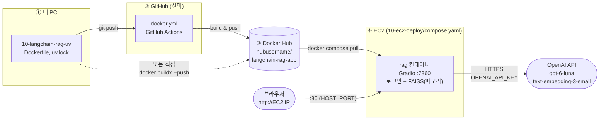

# ec2-deploy-langchain

10-langchain-rag-uv의 **PDF 질의응답(RAG) Gradio 앱**을 AWS EC2에 배포합니다.
메모 앱의 `ec2-deploy`와 같은 방식으로, EC2에서는 소스를 빌드하지 않고 **Docker Hub 이미지를 받아서 실행만** 합니다.



## 메모 앱 배포(ec2-deploy)와 비교

| 항목 | ec2-deploy (메모 앱) | 10-ec2-deploy (RAG 앱) |
|---|---|---|
| 컨테이너 | web + app + mariadb (3개) | **rag 1개** |
| DB, 볼륨 | MariaDB + 볼륨 | 없음 (FAISS는 메모리, 재시작하면 PDF 다시 업로드) |
| 외부 API | 없음 | **OpenAI** (질문, PDF 업로드마다 요금) |
| 비밀 값 | DB 비밀번호 | **OpenAI 키** + 로그인 비밀번호 |
| 로그인 | 없음 | **필수** (`APP_USERNAME`, `APP_PASSWORD`) |
| 포트 | 80 → web(nginx) 80 | 80(`HOST_PORT`) → rag 7860 |
| 이미지 | `boot-flyway-web`, `boot-flyway-app` | `langchain-rag-app` |

> **왜 로그인이 필수인가요?** 화면을 인터넷에 공개하면 주소를 아는 누구나 **내 OpenAI 키로** 질문하고 PDF를 올릴 수 있습니다. EC2를 열자마자 봇이 접속하는 것은 메모 앱 배포 때 nginx 로그에서 이미 확인했습니다. 로그인을 켜면 화면과 API가 모두 막힙니다(로그인 전 API 호출은 `401`).

## 파일 구성

```
ec2-deploy-langchain/     ← 이 폴더만 EC2에 복사 (소스 코드 불필요)
├── compose.yaml          # rag 서비스 1개, 이미지로 실행
├── .env.example          # Docker Hub 아이디, OpenAI 키, 로그인 계정, 포트
├── setup-ec2.sh          # Docker, Compose, 스왑 설치 (ec2-deploy 와 같음)
└── README.md
```

* * *

## 1. 이미지를 Docker Hub에 올리기 (내 PC)

이미지 이름은 `hubusername/langchain-rag-app`입니다. 두 방법 중 하나를 고르세요.

### 방법 A: GitHub Actions (07-2, 08-3과 같은 방식)

1. `10-langchain-rag-uv` 폴더를 새 GitHub 저장소로 올립니다 (예: `LangChain_RAG_GitActions`). `.github/workflows/docker.yml`이 포함되어 있습니다.
2. 저장소 **Settings > Secrets and variables > Actions**에 `DOCKER_USERNAME`, `DOCKER_PASSWORD`(Access Token)를 등록합니다. `OPENAI_API_KEY`는 등록하지 않습니다.
3. main에 push하면 Actions가 `:v1`, `:latest`를 올립니다. Actions 탭과 Docker Hub의 Tags를 확인하세요.

### 방법 B: 내 PC에서 직접 push

```bash
cd 10-langchain-rag-uv
docker login
# --platform linux/amd64: EC2(x86)용으로 빌드 (Apple Silicon Mac 에서도 x86 이미지가 만들어짐)
docker buildx build --platform linux/amd64 -t hubusername/langchain-rag-app:latest --push .
```

> 이미지에는 OpenAI 키가 들어가지 않습니다. `.env`는 `.dockerignore`로 빌드에서 빠지고, 키는 EC2의 `.env`로만 전달합니다.

## 2. EC2 준비

### 어디에 올릴지 정하기

| 경우 | `HOST_PORT` | 보안 그룹 인바운드 | 접속 주소 |
|---|---|---|---|
| **새 EC2에 이 앱만** | `80` | SSH 22 (내 IP), HTTP 80 | `http://EC2 IP` |
| 메모 앱이 있는 **같은 EC2에 함께** | `7860` | 기존 규칙 + 사용자 지정 TCP **7860** | `http://EC2 IP:7860` |

같은 EC2에 함께 올리면 80은 메모 앱의 web이 쓰므로 다른 포트를 씁니다. 두 앱이 메모리를 나눠 쓰므로 **t3.small(2GB) 이상**을 권장합니다.

### 새 EC2를 만든다면

메모 앱 배포와 같습니다 ([07-2 docs/04-ec2-deploy.md](../07-2-react-memo-flyway/docs/04-ec2-deploy.md) 참고).

| 항목 | 값 |
|---|---|
| AMI | Amazon Linux 2023 (kernel-6.18) |
| 아키텍처 | **64비트(x86)** (이미지가 amd64) |
| 인스턴스 유형 | t3.small 권장 (t3.micro 는 스왑 필요, 큰 PDF 처리 시 느림) |
| 스토리지 | gp3 20GB (이미지 약 1GB 이하) |

## 3. 파일 복사 + Docker 설치

```bash
# 내 PC (끝의 :~/ 를 빠뜨리면 내 PC에 폴더가 생김)
scp -i ./keys/my-key.pem -r ./ec2-deploy-langchain ec2-user@<EC2 IP>:~/
ssh -i ./keys/my-key.pem ec2-user@<EC2 IP>

# EC2 (새 EC2 라면 처음 한 번, 메모 앱이 있는 EC2 라면 이미 설치되어 있으니 건너뜀)
cd ~/ec2-deploy-langchain
bash setup-ec2.sh
exit          # 다시 접속해야 sudo 없이 docker 사용 가능
```

## 4. .env 작성 + 실행 (EC2)

```bash
ssh -i ./keys/my-key.pem ec2-user@<EC2 IP>
cd ~/ec2-deploy-langchain

cp .env.example .env
chmod 600 .env              # OpenAI 키가 들어가므로 나만 읽을 수 있게
nano .env                   # DOCKERHUB_USERNAME, OPENAI_API_KEY, APP_PASSWORD, HOST_PORT

docker compose config       # 경고 없이 image 이름, 포트가 맞는지 확인
docker compose pull
docker compose up -d
docker compose ps           # STATUS 가 (healthy) 가 될 때까지 (30초 정도)
docker compose logs -f rag
#   로그인 사용: APP_USERNAME / APP_PASSWORD
#   Gradio 서버 시작: http://0.0.0.0:7860 (업로드 최대 20mb)
```

로그에 `⚠️ 로그인 없이 외부 접속을 허용했습니다`가 보이면 `.env`의 `APP_USERNAME`, `APP_PASSWORD`가 비어 있는 것입니다. 고친 뒤 `docker compose up -d`로 다시 시작하세요.

## 5. 확인

| 주소 | 기대 결과 |
|---|---|
| `http://<EC2 IP>` (또는 `:7860`) | **로그인 화면** → 계정 입력 후 PDF 질의응답 화면 |
| 틀린 비밀번호 | 로그인 화면에 그대로 머묾 |

주소창에 **`http://`를 직접 입력**하세요. 생략하면 Chrome이 `https://`로 접속해 시간 초과가 납니다.

PDF를 올리고 질문하면 `docker compose logs -f rag`에서 처리 과정을 볼 수 있습니다.

```
새로운 PDF/설정 처리 중...
총 84페이지 로드됨
총 169개 청크로 분할됨
벡터 저장소 생성 완료!
하이브리드 검색기(키워드 + 벡터) 준비 완료
```

* * *

## 새 버전 배포

```bash
cd ~/10-ec2-deploy
docker compose pull && docker compose up -d
docker image prune -f
```

## 비용과 보안

| 항목 | 내용 |
|---|---|
| OpenAI 요금 | 질문 1번 약 $0.0015, PDF(30쪽) 임베딩 약 $0.002 이하 (`gpt-6-luna`, `text-embedding-3-small`) |
| **사용 한도** | OpenAI 플랫폼 > Billing 에서 **월 한도**를 꼭 정해 두기 |
| 전용 키 | 이 서버용 키를 따로 만들면, 유출됐을 때 그 키만 삭제하면 됨 |
| 로그인 | `APP_PASSWORD`는 길게, 수강생과 공유한다면 실습 후 바꾸기 |
| 업로드 크기 | `APP_MAX_FILE_SIZE` (기본 20mb), 큰 PDF 는 임베딩 비용과 메모리가 커짐 |
| HTTP | 로그인 비밀번호가 암호화 없이 전송됨. 실제 서비스라면 도메인 + HTTPS(Let's Encrypt) 를 붙일 것 |
| EC2 요금 | 실습이 끝나면 인스턴스 종료, 탄력적 IP 릴리스 ([정리 방법](../07-2-react-memo-flyway/docs/04-ec2-deploy.md#8-실습을-마칠-때)) |

## 문제 해결

| 증상 | 원인 | 해결 |
|---|---|---|
| `docker compose config`에 `variable is not set` 경고 | `.env`에 값이 없음 | 경고에 나온 이름을 `.env`에 입력 |
| 컨테이너가 바로 `Exited (1)` | `OPENAI_API_KEY` 없음 | `docker compose logs rag`에서 ValueError 확인, `.env` 수정 |
| 로그인 화면 없이 바로 앱이 열림 | `APP_USERNAME` 또는 `APP_PASSWORD`가 비어 있음 | `.env` 수정 후 `docker compose up -d` |
| 접속 시간 초과 | 보안 그룹에 포트 없음, 또는 `https://`로 접속 | 보안 그룹에 `HOST_PORT`(80 또는 7860) 추가, `http://` 직접 입력 |
| `port is already allocated` | 같은 EC2 의 다른 컨테이너(메모 앱 web)가 80 사용 중 | `.env`의 `HOST_PORT=7860` |
| `exec format error` | ARM 인스턴스, 또는 Apple Silicon 에서 `--platform` 없이 빌드 | x86 인스턴스, `--platform linux/amd64`로 다시 빌드 |
| PDF 업로드 중 컨테이너 재시작 (exit code 137) | 메모리 부족 | `free -h`로 스왑 확인, 인스턴스 키우기, `mem_limit` 늘리기 |
| 채팅창에 `Error code: 401` / `429` | OpenAI 키 오류 / 결제, 한도 | OpenAI 플랫폼에서 키, Billing 확인 |
| 첫 PDF 업로드 때 `openaipublic.blob.core.windows.net` 오류 | EC2 의 나가는 통신이 막힘 (보통은 열려 있음) | 보안 그룹 아웃바운드, 네트워크 ACL 확인 |
| 재시작 후 이전 PDF 로 답변 못 함 | FAISS 가 메모리에만 있음 | 정상, PDF 다시 업로드 |
| 문서에 있는 내용인데 "찾을 수 없습니다" | 검색 단계 문제 | [10-langchain-rag-uv README의 하이브리드 검색](../10-langchain-rag-uv/README.md#검색-개선-하이브리드-검색-키워드--벡터) 참고 |

## 정리

```bash
docker compose down              # 컨테이너 삭제 (볼륨이 없으므로 남는 데이터 없음)
docker rmi hubusername/langchain-rag-app:latest
```
